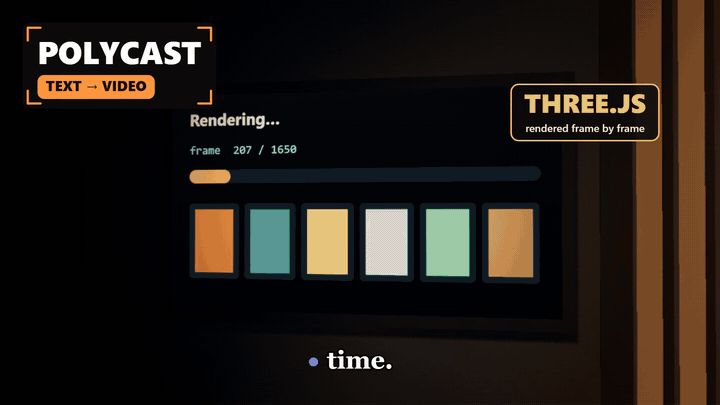
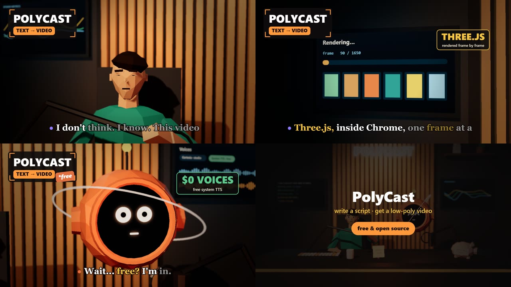

<div align="center">

# 🎙️ PolyCast

### Write a script. Get a low-poly 3D video.

A host and a sarcastic floating AI orb banter in a cozy podcast studio.<br>
PolyCast voices them, lip-syncs them, directs the camera, puts your screens on the wall,<br>
and renders a finished MP4 with captions and music.

[](LICENSE)




**▶ [Watch the full 45-second demo](docs/polycast-demo.mp4)**. It was made entirely with PolyCast: one `lines.json` and one CONFIG block, voiced by Cartesia. It works the same with the free built-in voices.

</div>

---

## Table of contents
- [Why PolyCast](#-why-polycast)
- [Quick start with Claude Code](#-quick-start-with-claude-code)
- [Quick start by hand](#-quick-start-by-hand)
- [How a video is made](#-how-a-video-is-made)
- [Voices: free or studio](#-voices-free-or-studio)
- [Templates](#-templates)
- [Docs, contributing, license](#-docs-contributing-license)

## 💡 Why PolyCast



- **No animation skills needed.** You write the dialogue; the characters act it out.
- **No paid voice account needed.** It uses your computer's own voice by default, or [Cartesia](https://cartesia.ai) for studio quality.
- **Real lip-sync.** Mouths follow the actual audio of every line.
- **Edits that stay in sync.** Every camera cut, screen and joke is cued to a *word*, so regenerating the voices never breaks the timing.
- **Your product on screen.** Drop screenshots into `img/` and they play on the studio monitors.
- **Ready to post.** 1920×1080 or 1080×1920, H.264 + AAC at -16 LUFS, captions burned in.
- **Claude Code native.** Install it as a skill, describe the video, and get an MP4.

Good for product launches, portfolio intros, feature explainers, devlogs, course trailers, and talking-head-free YouTube Shorts and Reels.

## 🤖 Quick start with Claude Code

```bash
# macOS / Linux
git clone https://github.com/<your-username>/polycast ~/.claude/skills/polycast

# Windows (PowerShell)
git clone https://github.com/<your-username>/polycast $HOME\.claude\skills\polycast
```

Open [Claude Code](https://claude.com/claude-code) in any folder and ask:

> *"Make a PolyCast video about my budgeting app. 45 seconds. The orb thinks spreadsheets are enough, the host proves it wrong. Use the screenshots in ./shots."*

Claude runs the setup check, writes the script, generates and verifies the voices, directs the scene, previews the frames, and hands you the MP4. The instructions it follows are in [`SKILL.md`](SKILL.md).

## 🛠️ Quick start by hand

You need **Node 18+**, **ffmpeg**, and **Google Chrome** (or Chromium/Edge). The doctor checks all of them and tells you how to fix anything missing.

```bash
git clone https://github.com/<your-username>/polycast && cd polycast
npm run doctor                              # installs packages, checks ffmpeg/Chrome/voices

npm run new -- videos/hello studio          # 1. scaffold an episode
#  edit videos/hello/lines.json             # 2. write the script
npm run voice -- videos/hello               # 3. generate voices (free by default)
#  edit the CONFIG block in videos/hello/scene.js   # 4. direct it
npm run preview -- videos/hello             # 5. check frames/sheet.jpg
npm run build -- videos/hello hello.mp4     # 6. render the final video
```

A 50-second 1080p video renders in about 5–10 minutes on a normal laptop. Previews take seconds.

## 🎬 How a video is made

**1. The script** (`lines.json`): who says what.
```json
{ "id": "o01", "who": "orb",  "text": "So you think a text file can make a whole video?" },
{ "id": "h02", "who": "host", "text": "Three.js, inside Chrome.", "say": "Three J S, inside Chrome." }
```
`say` fixes pronunciation while the captions keep `text`.

**2. The direction** (`scene.js` → `CONFIG`): every cue is `[lineId, word]`.
```js
camera:   [ [['o01'], 'two'], [['o02'], 'orbClose'], [['h02'], 'monL'] ],
monitors: [ [['h02'], 'img:dashboard.png', 'voices'] ],
acting:   [ [['o01'], ['h01'], { orb: 'side', hostTurn: 0.5 }] ],
cards:    [ [['h03', 'mouth'], ['o04'], 'LIP-SYNC', 'to the real audio', '#5cc98a'] ],
contact:  { at: ['h06', 'free'], big: 'you@example.com', small: 'yoursite.com' },
```

**3. The pipeline**

```
lines.json ─► voice.js ─► vo/*.wav + timeline.json
                              │
scene.js ───► render.js (three.js in headless Chrome, frame by frame, lip-sync from audio) ─► video.mp4
                              │
mix.js ─────► voices + ducked lo-fi bed + UI pops ─► audio_mix.wav ─► ffmpeg ─► final.mp4
```

The full reference covers every shot, screen, expression, card, resolution and troubleshooting tip: **[docs/GUIDE.md](docs/GUIDE.md)**.

## 🗣️ Voices: free or studio

| | Free (default) | Studio |
|---|---|---|
| Engine | Windows SAPI · macOS `say` · Linux `espeak-ng` | [Cartesia](https://cartesia.ai) Sonic |
| Cost | $0, offline | Paid API (free tier available) |
| Setup | Nothing (Linux: `sudo apt install espeak-ng`) | `cp .env.example .env` and paste `CARTESIA_API_KEY` |
| Extras | Robot / radio / deep effects | Plus `--verify`: speech-to-text check of every line |

PolyCast picks Cartesia automatically when a key is present. Force either one with `"provider": "system"` or `"cartesia"` in `lines.json`.

## 🎞️ Templates

| `studio` | `retro-horror` |
|---|---|
| 1920×1080 · warm podcast studio · soft shadows · depth of field · neon · wall monitors | 1080×1920 · PS1-style horror · dithering · vertex wobble · VHS overlay |
| Speakers: `host`, `orb` | Speakers: `nar`, `danny`, `woman` |

```bash
npm run new -- videos/scary retro-horror
```

Want a news desk, a sci-fi bridge or a cooking show? Templates are just folders. See [CONTRIBUTING.md](CONTRIBUTING.md).

## 📚 Docs, contributing, license

- **[docs/GUIDE.md](docs/GUIDE.md):** the complete reference
- **[SKILL.md](SKILL.md):** the workflow Claude follows
- **[CONTRIBUTING.md](CONTRIBUTING.md):** new templates, screens, expressions, voice providers
- **[CHANGELOG.md](CHANGELOG.md)**
- `npm run check`: validates scripts, templates, and that every scene cue points at a real line

Released under the **[MIT License](LICENSE)**. Use it for anything, commercial included. If PolyCast makes you a video you like, a ⭐ helps others find it.

<div align="center">
<sub>Built by <b>Maham Sultana</b> · characters and sets are original low-poly models generated in code</sub>
</div>
